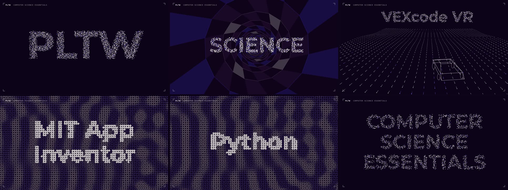

# EOMD: Efficient Offline Motion Designer

Motion graphics and music that live in a single HTML file. The picture is drawn live on a canvas by JavaScript, and
the music is synthesized by JavaScript too (live in the browser, or rendered once and tucked inside the file): no video
editor, no stock footage, no After Effects, no internet once it's built. Open the file and it plays. When you want a
video, one tool turns it into an MP4.

**Play them in your browser right now:** https://bpmdata.github.io/EOMD/

### Featured: PLTW Computer Science Essentials (60 s)

**[▶ Watch it with sound](https://bpmdata.github.io/EOMD/players/pltw-cse.html)** (press START)

[](https://bpmdata.github.io/EOMD/players/pltw-cse.html)

Every word is made out of the picture itself: thousands of 3D dots fly into **PLTW**, words made of dots fly down a
tunnel and burst past the camera, a self-driving car scans the road with lidar while dots drop from the sky to spell
**VEXcode VR** and **VEXcode EXP**, and a maze of tiles flips itself to spell **MIT App Inventor** and **Python**.
The soundtrack was composed in code for this video, with every hit timed to the picture. See
[how it works](#how-the-pltw-video-works) below.

It started as screens for a high school (hallway loops, classroom posters, a retro computer-lab screensaver), but
nothing here is classroom-only. Make whatever you want. Animate your tax returns.

## How it's meant to be used

**Clone the whole repo to your drive and let your AI coding assistant go nuts.** Claude Code, Qwen via AnythingLLM,
Cursor, Aider, whatever you use: point it at this folder and describe what you want.

```bash
git clone https://github.com/BPMData/EOMD.git
```

The repo is set up for that:
- **`CLAUDE.md`** is the map: what every file does, when to open it, the house rules and how to build. Claude Code reads it
  automatically; with any other assistant, tell it "read CLAUDE.md and STATUS.md first".
- **`STATUS.md`** is the working state: what's finished, what's untested, what's next.
- **Pieces are small JSON "cartridges"** (see below), so asking an AI for a new piece costs a short JSON file instead of
  a new 600-line program, and the math (noise, 3D, physics, the music arranger) never has to be rewritten.

## Try it now (no build needed)

**`players/`** has finished, ready-to-play builds. Double-click any of them (Chrome, Edge, Firefox or Safari); press
Start sound for the music. Move the mouse to see the controls.

| File | What it is |
|---|---|
| `players/jukebox.html` | Every music cartridge: lounge, film scores, study loops, chip music. Endless, and the same seed always plays the same music |
| `players/cdrom-player.html` | CS Lab Screensaver: five retro computer worlds (DOS prompt, ASCII world, a maze, a contour desk with an airship, a starfield), chip music, trilingual coding-tip cards, a session timer |
| `players/cdrom-ambient.html` | The same screensaver without the tip cards |
| `players/living-player.html` | Living poster: vines grow across the screen and write words in cursive, with a reading-room soundtrack and timer |
| `players/living-player-cs.html` | Living poster with trilingual (EN/ES/PT) computer-science tip cards |
| `players/living-player-ex.html` | Living poster with trilingual cards for a 9th-grade Exploration Seminar |
| `players/pltw-cse.html` | The PLTW Computer Science Essentials promo above (60 s, with music) |
| `players/gen-player.html` | The generative library below as one self-contained file (USB-stick ready) |

- **Generative motion library:** double-click **`gen/player.html`**. Press **G** for the gallery of ready-made
  cartridges (Truchet tiles, 3D dot meshes, dot swarms that fly into words, flow fields, Julia sets, tunnels,
  reaction-diffusion, kinetic type, Dust Type ...), **K** for the knobs. Drag sliders until it looks right, press **COPY JSON**, save it as
  `gen/carts/<your-piece>.json`: that's a new piece. `gen/README.md` has the full walkthrough (including kinetic-type
  music videos from a Whisper transcript), `gen/API.md` is the one-page reference for AIs.
- **A finished film:** `academies-film/danbury-academies-player.html`, a 60-second seamless hallway loop with its own
  synthesized soundtrack, all in one file.

## Build your own

Builds land in `dist/` (not in git); `players/` holds published copies of them. The build scripts are plain Python with every setting at the top,
so they run from Thonny or any editor's Run button, or from a terminal.

| You want | Run | Then open |
|---|---|---|
| The **jukebox** (every music cartridge, endless and seeded) | `tools__build.py` with `TARGETS = ['jukebox']` | `dist/jukebox.html` |
| A **living poster** (vines that grow and write words) | `tools__build.py` with `TARGETS = ['living']`, pick `LIVING_VARIANT` and `LIVING_SCORE` | `dist/living-player*.html` |
| The **CD-ROM screensaver** (five retro computer worlds, chip music) | `tools__build_cdrom.py` (and `tools__cdrom_ambient.py` for the version without tip cards) | `dist/cdrom-player.html` |
| A **self-contained gen player** to put on a USB stick | `python3 gen/build.py` | `gen/dist/gen-player.html` |
| **One gen cartridge as its own HTML and/or an MP4 with its music** | run `tools__gen_export.py` (pick cartridge + folder) | the folder you picked |

The first build downloads the open-source fonts (SIL OFL, from Google Fonts' GitHub) and caches them; after that,
everything is offline. `tools__build.py` needs `pip install fonttools brotli`.

### Music
Each piece of music is a **score cartridge**: a ~2 KB `score__*.json` that the arranger turns into an endless (or
looping) stream. `score__FORMAT.md` explains every field. To make one: copy a score, change it, run
`tools__calibrate.py` (sets the loudness and writes an MP3 preview), listen, then rebuild the jukebox.
`tools__midi.py` exports any score to a multitrack MIDI file.

## Make an MP4

**gen cartridges:** run **`tools__gen_export.py`**: pick a cartridge, pick a folder, press MAKE MP4 (or MAKE HTML for a
standalone player, or MAKE BOTH). The cartridge's music is laid in exactly in sync.

**Any other player:** run **`tools__html_to_mp4.py`** (a small window: pick a player `.html`, pick where to save, press RENDER).

- **Films** (like the Academies loop) render frame-exact, with the music synthesized offline in sync.
- **Everything else** (living posters, the screensaver) is stepped one frame at a time, so
  nothing drops, at any length. Their music is recorded from a second, real-time play of the page, so it isn't locked to
  the picture (fine for most things; it means a 10-minute clip takes about 10 minutes for the music plus the frames).
- **URL options** pick what plays: `vseed=7` for a living poster, `noboot` to skip the screensaver's boot screen.
- Size presets: 1080p landscape, 1080×1920 portrait, 4K, 720p.

It needs **ffmpeg** (macOS: `brew install ffmpeg`; the tool finds it, or press BROWSE) and **Playwright** with Chromium:

```bash
pip install playwright
```
```bash
python -m playwright install chromium
```

## Requirements

- Python 3 (Thonny works; the GUI tools use Tk, which ships with Python)
- A modern browser to play the players (Chrome, Edge, Firefox, Safari)
- Node.js for the audio tools (`tools__regress.py`, `tools__midi.py`, `tools__porter.py`, `tools__render_piece.py`) and `gen/tests/smoke.js`
- ffmpeg + Playwright for MP4 export; `fonttools` + `brotli` for `tools__build.py`

## How the PLTW video works

The whole thing is a 55-line JSON cartridge (`gen/carts/pltw-cse.json`) driving reusable layers, plus a score written in
JavaScript (`proj__pltw__music.js`). A few of the ideas, if you're curious:

- **Text becomes points.** To make a word out of dots, the word is drawn once on a hidden canvas, and the code reads back
  which pixels are lit and spreads N points evenly over them (`GEN.core.textPoints` in `gen/core.js`). Any formation
  (a starfield, a sphere, a knot, a floor, a word) is just a list of N positions, so morphing is "move point *i* from
  its old spot to its new spot".
- **3D on a 2D canvas.** Each point is rotated around the camera, then divided by its distance (perspective:
  `screen = center + x × focal / z`). Far dots get smaller and fade, which is all it takes to look 3D
  (`gen/m3d.js`, `gen/layers/swarm.js`).
- **Motion is a pure function of time.** Every frame is computed from the clock alone (position = f(t)), never from
  the previous frame. That's why the video can be rendered one exact frame at a time, and why skipping ahead is free.
- **The car's lidar** is a rotating angle: any floor dot whose direction from the car is just behind the beam lights up.
- **The music is math too.** Every sound (kick drum, bass, chiptune lead, the blips as dots fly into place) is built
  from oscillators, noise and filters, sample by sample, then mixed, measured for loudness (−16 LUFS) and limited,
  all in plain JavaScript (`engine__src__audio__dsp.js`). Its timeline (`CUES`) is the video's timeline.

It was designed and built with an AI coding assistant (Claude Code) working inside this repo, which is the point of
the project: the reusable parts are already here, so a new piece is mostly a short cartridge and good ideas.

## Why the file names look like `audio__style-lounge.js`

Most of the repo is flat on purpose: in a file name, `__` stands for a folder (`audio__style-lounge.js` =
`audio/style-lounge.js`). A flat folder is easy to upload to AI chat tools that don't take folders, and the build
scripts accept either form. `gen/`, `players/`, `academies-film/`, `fonts/` and `media/` are real folders.

## Sharing your cartridges

A proper way to submit your own gen cartridges and music scores is planned. Until then, open a pull request that adds
your `gen/carts/<name>.json` or `score__<name>.json` (run `gen/build.py` + `node gen/tests/smoke.js`, or
`tools__calibrate.py` for a score, first), or post it in an issue.

## License

Code: MIT, © 2026 Bryan Patrick Murphy (see `LICENSE`). Fonts keep their own SIL Open Font License (`fonts__OFL-*.txt`,
`gen/fonts/OFL-Montserrat.txt`, `academies-film/source/fonts/OFL.txt`). The Academies of Danbury High School names and
logos in `academies-film/` and `proj__academies__*` belong to the school; they're here as an example piece and aren't
covered by the MIT license.
